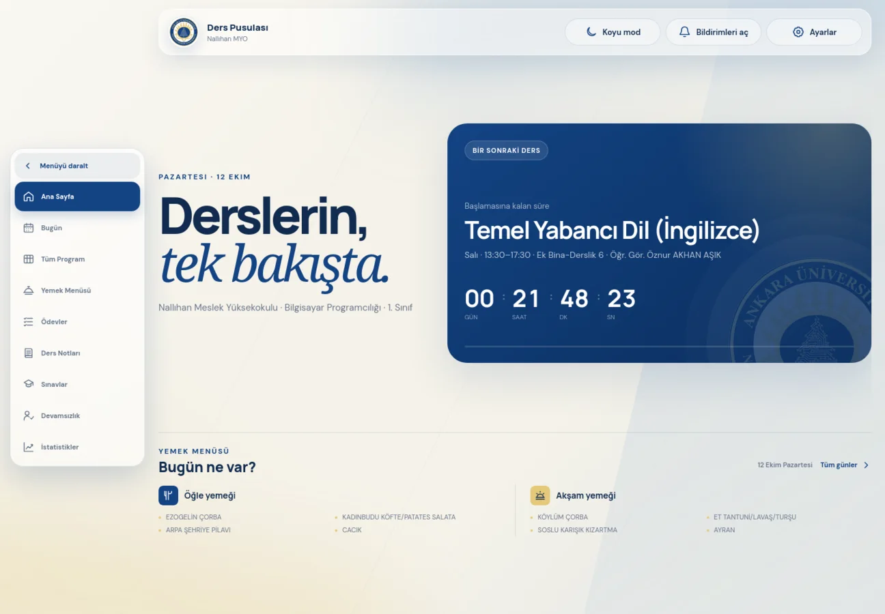

<p align="center">
  
</p>

<h1 align="center">Ders Pusulası</h1>

<p align="center">
  Nallıhan MYO öğrencileri için ders programı, yemek menüsü ve akademik takip uygulaması.
</p>

<p align="center">
  <a href="https://icarusexe.github.io/ders-programi/"><strong>Uygulamayı aç</strong></a>
  ·
  <a href="#yerelde-çalıştırma">Yerelde çalıştır</a>
  ·
  <a href="#verileri-güncelleme">Verileri güncelle</a>
</p>

<p align="center">
  
  
  
  
  
</p>

<p align="center">
  <a href="https://icarusexe.github.io/ders-programi/">
    
  </a>
</p>

## Neler sunuyor?

| Günlük kullanım | Akademik takip |
| --- | --- |
| Günün dersleri ve canlı geri sayım | Ödev oluşturma, filtreleme ve tamamlama |
| Haftalık ders programı | Ders notları ve kaynak bağlantıları |
| Günlük öğle ve akşam menüsü | Sınav sonucu ve hedef final hesabı |
| Açık/koyu tema ve altı renk paleti | Devamsızlık ve risk takibi |
| Çevrimdışı PWA ve sürüm güncelleme bildirimi | Ders bazlı istatistikler |
| Ders ve ödev bildirimleri | Kodla eşleşen cihazlar arasında canlı senkronizasyon |
| Büyük yazı, yüksek kontrast ve azaltılmış hareket | Çakışma korumalı cihazlar arası yedekleme |

İlk kullanımda İngilizce muafiyet tercihi sorulur. Muaf öğrenciler Temel Yabancı Dil dersini programdan ve bildirimlerden gizleyebilir; tercih daha sonra Ayarlar bölümünden değiştirilebilir.

Uygulama framework kullanmadan hazırlanmıştır. Kişisel kayıtlar varsayılan olarak tarayıcının `localStorage` alanında tutulur. Bulut yedekleme açılırsa yalnızca tarayıcıda şifrelenen veri Worker'a gönderilir.

## Yerelde çalıştırma

Depoyu klonla ve basit bir yerel sunucu başlat:

```bash
git clone https://github.com/icarusexe/ders-programi.git
cd ders-programi
python3 -m http.server 8000
```

Ardından [http://localhost:8000](http://localhost:8000) adresini aç. Uygulama JSON verilerini `fetch()` ile okuduğu için `index.html` dosyasını doğrudan açmak yerine HTTP sunucusu kullanılmalıdır.

## Verileri güncelleme

### Ders programı

Dersler [`schedule.json`](schedule.json) içindeki `courses` listesinde tutulur:

```json
{
  "day": 1,
  "start": "09:00",
  "end": "10:40",
  "code": "BPR101",
  "name": "Programlama Temelleri",
  "room": "Bilgisayar Laboratuvarı",
  "instructor": "Öğr. Gör. Ad Soyad"
}
```

Gün numaraları `0` Pazar, `1` Pazartesi, ... `6` Cumartesi biçimindedir.

### Yemek menüsü

Yeni öğle ve akşam Excel dosyalarını tek komutla [`menu.json`](menu.json) biçimine dönüştürebilirsin:

```bash
python3 scripts/import-menus.py /dosya/yolu/oglemenu.xlsx /dosya/yolu/aksammenu.xlsx menu.json
```

İçe aktarıcı tarihleri, yemek satırlarını ve kalori toplamlarını denetler; kaynak dosyadaki şüpheli değerleri terminalde bildirir.

## PWA ve bildirimler

Site telefona veya bilgisayara uygulama olarak kurulabilir. Service Worker temel dosyaları, programı ve menüyü önbelleğe alır. Desteklenen tarayıcılarda bildirim zamanı **Ayarlar → Bildirim tercihleri** bölümünden değiştirilebilir.

- Android ve masaüstünde bildirimler HTTPS üzerinden çalışır.
- iPhone ve iPad'de site önce **Ana Ekrana Ekle** ile kurulmalıdır.
- `push-config.js` içindeki `apiUrl` boşsa hatırlatmalar yalnızca uygulama açıkken çalışır.
- Cloudflare Worker etkinse site kapalıyken de Web Push bildirimi gönderilebilir.

<details>
<summary><strong>Cloudflare Worker kurulumunu göster</strong></summary>

Arka plan bildirimleri için `worker/` klasöründe Cloudflare Workers, D1 ve Cron tabanlı servis bulunur. Kurulum için Node.js 20+ ve bir Cloudflare hesabı gerekir.

1. Bağımlılıkları kur ve Cloudflare hesabına giriş yap:

   ```bash
   cd worker
   npm install
   npx wrangler login
   ```

2. D1 veritabanını oluştur:

   ```bash
   npx wrangler d1 create ders-pusulasi-push
   ```

3. Dönen `database_id` değerini `worker/wrangler.toml` dosyasına yaz. `ALLOWED_ORIGINS`, `SITE_URL` ve `VAPID_SUBJECT` değerlerini kendi GitHub Pages adresine göre düzenle.

4. Şemayı uzak veritabanına uygula:

   ```bash
   npm run db:migrate:remote
   ```

5. VAPID anahtarlarını üret ve Cloudflare sırları olarak kaydet:

   ```bash
   npm run vapid
   npx wrangler secret put VAPID_SERVER_PUBLIC_KEY
   npx wrangler secret put VAPID_SERVER_PRIVATE_KEY
   ```

6. Worker'ı yayınla:

   ```bash
   npm run deploy
   ```

7. Yayınlanan adresi kök dizindeki `push-config.js` dosyasına ekle:

   ```js
   window.DERS_PUSULASI_PUSH = {
     apiUrl: "https://ders-pusulasi-push.KULLANICI-ALT-ALANI.workers.dev",
   };
   ```

VAPID özel anahtarını repoya ekleme. Anahtarlar değiştirilirse mevcut cihazların yeniden abone olması gerekir.

### Canlı cihaz eşitlemeyi etkinleştirme

Canlı eşitleme aynı Worker ve D1 veritabanını kullanır. `worker/schema.sql` güncel şema ile uzak veritabanına uygulandıktan sonra Worker'ı yeniden yayınla:

```bash
cd worker
npm run db:migrate:remote
npm run deploy
```

Veri uygulamadan çıkmadan önce AES-GCM ile şifrelenir. Worker yalnızca şifreli içeriği saklar; eşleştirme kodunun kendisi sunucuya gönderilmez. Bir cihazda oluşturulan kod diğer cihazlara girildikten sonra ödev, not, devamsızlık ve tercihler birkaç saniye içinde iki yönlü eşitlenir ve açık ekranlar yenileme gerektirmeden güncellenir. Aynı anda yapılan değişiklikler kayıt kimliği ve güncelleme zamanına göre birleştirilir; silinen kayıtlar yeniden oluşmasın diye şifreli eşitleme bilgisinde işaretlenir. Ayarlardan cihaz bağlantısı kesilebilir veya bulut kaydı kalıcı olarak silinebilir.

</details>

## Proje yapısı

```text
.
├── index.html                # Uygulama arayüzü
├── styles.css               # Tema ve responsive tasarım
├── app.js                   # Uygulama davranışı
├── schedule.json            # Ders programı
├── menu.json                # Öğle ve akşam menüleri
├── service-worker.js        # PWA önbelleği ve bildirimler
├── scripts/import-menus.py  # Excel menü içe aktarıcısı
└── worker/                  # İsteğe bağlı Web Push servisi
```

## GitHub Pages'te yayınlama

1. GitHub deposunda **Settings → Pages** bölümünü aç.
2. Kaynak olarak **Deploy from a branch** seç.
3. `main` dalını ve `/ (root)` klasörünü seçip kaydet.
4. Site birkaç dakika içinde `https://KULLANICI-ADIN.github.io/REPO-ADI/` adresinde yayınlanır.

> [!NOTE]
> Ders programı ve yemek listesi kuruma bağlı güncel verilerdir. Yayınlamadan önce `schedule.json` ve `menu.json` içeriklerini doğrula.

## Testler

Proje veri dosyaları, HTML varlıkları, Service Worker önbelleği ve D1 şeması Python standart kütüphanesiyle test edilir. Worker işlev testleri Node.js'in yerleşik test çalıştırıcısını kullanır:

```bash
python3 -m unittest discover -s tests -v
cd worker
npm ci
npm test
```

`.github/workflows/ci.yml` bu kontrolleri `main` dalına gönderilen her committe ve pull request'lerde otomatik çalıştırır.
